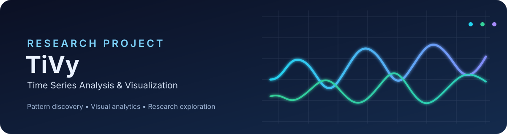
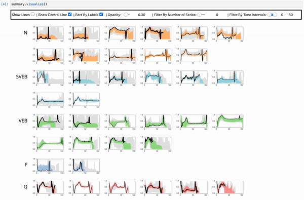
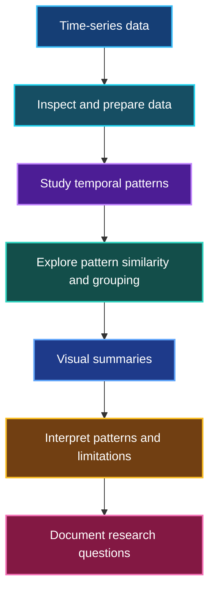

<div align="center">
  

  <br />

  
  
  

  **Exploring scalable visual summaries for time-series data**

  *A research-learning repository for understanding TiVy, time-series pattern discovery, and visual analytics.*
</div>

---

## ✨ About the project

Time-series datasets can contain many signals and long sequences, making it difficult to inspect recurring temporal patterns with traditional plots alone. This repository studies **TiVy (Time Series Visual Summary)**, a research approach for summarizing and visualizing patterns across time-series data.

The repository includes the original TiVy source code, example Jupyter notebooks, a demonstration GIF, and related research/presentation materials. The current focus is on **studying the paper and code, understanding the workflow, and identifying possible extensions**. This README does not claim that every method described below has been independently implemented or evaluated in this project.

> **Project status:** Research and learning in progress. Any new experiments, clustering comparisons, forecasting baselines, or interface improvements should be documented here only after they have actually been implemented and tested.

## 🎞️ TiVy demo

The GIF below is included with the TiVy project files and illustrates the project's visualization interface.

<p align="center">
  
</p>

## 🧭 Conceptual workflow

The diagram is a **high-level study guide**, not a guarantee that every box represents a separately implemented component in this repository. Use the notebooks and original paper to verify the exact algorithmic steps.



## 🔎 Research focus

Current learning goals include:

- Understand the motivation and design of scalable time-series visual summaries.
- Study how the supplied TiVy implementation and notebooks demonstrate the method.
- Explore how repeated or similar temporal patterns can be inspected visually.
- Record limitations, reproducibility issues, and questions that arise while reading the paper and running examples.

### Potential future directions

These are **ideas for future exploration**, not completed features unless supported by later code and results:

- Compare alternative measures of time-series similarity.
- Explore clustering methods and evaluate whether they help organize temporal patterns.
- Investigate a simple Linear Regression forecasting baseline on a clearly defined dataset.
- Improve the presentation of visual summaries and document usability findings.
- Build reproducible experiments with stated datasets, metrics, and limitations.

## 🗂️ Repository contents

```text
Time-Series-Analysis-Data-Visualization-main/
├── README.md
├── assets/
│   └── tivy-banner.svg
└── TiVy/
    ├── LICENSE
    ├── README.md
    ├── TiVy.py
    ├── TSVis/
    │   ├── buffer.py
    │   ├── geometry.py
    │   ├── synthetic_data.py
    │   ├── util.py
    │   └── widget.py
    ├── notebook examples/
    │   ├── ECG Clustering.ipynb
    │   ├── Grid Search Illustration.ipynb
    │   └── Simple Illustration.ipynb
    ├── requirements.txt
    ├── time-series-demo.gif
    ├── TiVy_Time_Series_Visual_Summary_for_Scalable_Visualization.pdf
    └── TiVy_ppt1.pdf
```

- `TiVy/TiVy.py` and `TiVy/TSVis/` contain the supplied TiVy implementation.
- `TiVy/notebook examples/` contains example notebooks for exploring the project.
- `TiVy/time-series-demo.gif` is the demonstration animation embedded above.
- The PDF files are research/presentation materials included in the archive. Their rights may differ from the source-code license.

## 🛠️ Getting started

The original TiVy instructions recommend setting up **VisPy and its Jupyter extension** before installing the remaining Python dependencies. See the [VisPy installation guide](https://vispy.org/installation.html) and the project-specific instructions in [`TiVy/README.md`](TiVy/README.md).

From the repository root, install the dependencies listed by the original project:

```bash
cd TiVy
python -m pip install -r requirements.txt
```

Then follow the VisPy/Jupyter setup steps in `TiVy/README.md` and open one of the notebooks in `TiVy/notebook examples/`.

> **Environment note:** Interactive visualization dependencies can be sensitive to Python, Jupyter, and operating-system versions. If setup fails, record your environment and the exact error rather than assuming the examples have been validated on every system.

## 📚 Research paper

**Chan, Gromit Yeuk-Yin; Nonato, Luis Gustavo; Palpanas, Themis; Silva, Cláudio T.; and Freire, Juliana.** “TiVy: Time Series Visual Summary for Scalable Visualization.” *IEEE Transactions on Visualization and Computer Graphics*.

- DOI: [10.1109/TVCG.2025.3633882](https://doi.org/10.1109/TVCG.2025.3633882)
- The repository also includes a PDF copy of the paper. Check the paper's own terms before redistributing it outside this repository.

If you use the original TiVy method or code in academic work, cite the paper and follow its official citation guidance. The original TiVy README contains a BibTeX example; verify its publication metadata against the publisher record before reusing it.

## 🧰 Tools and materials

- **Python** — source code and notebook exploration
- **Jupyter Notebook** — interactive examples
- **VisPy** — visualization dependency described by the original project
- **TiVy research paper and presentation** — study materials
- **Mermaid** — workflow diagram in this README
- **Shields.io** — README badges

## 📌 Progress and reproducibility

To keep this repository credible and useful, add a short experiment log when new work is performed:

1. Dataset and source
2. Environment and dependencies
3. Method or parameter settings
4. Evaluation approach and observed results
5. Limitations and next steps

Do not report model scores, clustering quality, forecasting accuracy, or performance improvements unless they have been measured and recorded.

## ⚖️ Attribution and licensing

This repository includes the TiVy source code and related materials from the original project. The license file at [`TiVy/LICENSE`](TiVy/LICENSE) specifies the **BSD 3-Clause License** for the material it covers. Preserve the required copyright and license notices when redistributing covered source code.

The code license should **not automatically be assumed to cover the research paper, slides, or other third-party assets**. Confirm their respective permissions before copying or redistributing them elsewhere. This repository is for learning and research exploration; identify the original authors and clearly distinguish the original TiVy implementation from any modifications or experiments you personally add.

## 🔗 Useful links

- [Research paper (DOI)](https://doi.org/10.1109/TVCG.2025.3633882)
- [VisPy installation guide](https://vispy.org/installation.html)
- [Mermaid documentation](https://mermaid.js.org/)
- [Plotly Python documentation](https://plotly.com/python/)
- [Shields.io badge maker](https://shields.io/)

---

<div align="center">
  <sub>Built for careful reading, reproducible experiments, and better understanding of time-series visual analytics.</sub>
</div>
